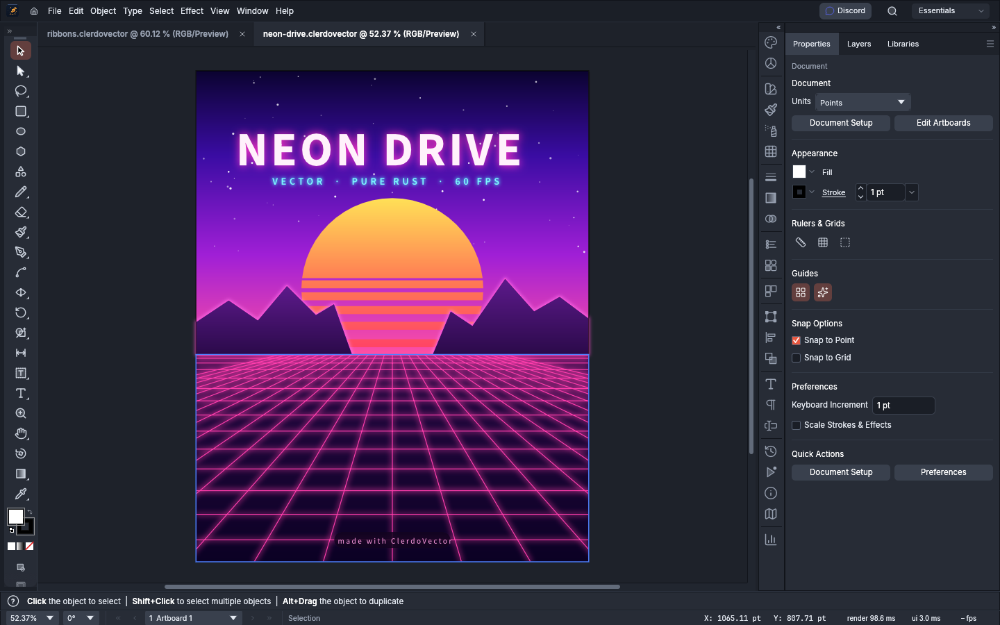

<p align="center">
  <a href="https://clerdo.app">
    
  </a>
</p>

<h1 align="center">ClerdoVector</h1>

<p align="center">
  <b>A free, open-source vector illustration app by Clerdo.</b><br>
  Pen, shapes, type, brushes, gradients, effects and pro file formats. Windows, macOS, Linux and the web.
</p>

<p align="center">
  <a href="https://clerdo.app">Website</a> ·
  <a href="https://discord.gg/CHu4QqrWtf">Discord</a> ·
  <a href="../../releases/latest">Download</a> ·
  <a href="LICENSE-MIT">MIT</a> / <a href="LICENSE-APACHE">Apache-2.0</a>
</p>

<p align="center">
  
</p>

## What it does

- **Draw:** Pen, Curvature, Pencil, brushes and the Blob Brush, shape tools, Shape Builder and
  Pathfinder, Width, Warp and Free Transform, Live Paint, gradients and gradient meshes.
- **Type:** point, area and path type with paragraph and character styles, threading, OpenType
  features, and right-to-left scripts.
- **Effects:** an Appearance panel with live effects, transparency and blending modes, Envelope
  Distort, Blends, Repeat and 3D Revolve.
- **Files:** its own open format (`.clerdovector`, documented JSON), SVG, PDF and PDF-compatible
  `.ai`, EPS, DXF, EMF/WMF, Affinity documents (open only), PNG, JPEG, WebP, GIF, TIFF and PSD.
- **Automation:** every menu item, tool and panel can be driven over a JSON control channel and an
  MCP server, so AI agents can draw and edit the way a person does.
- **Languages:** the interface is translated into 22 languages.

## Download

Get the latest build from the [Releases page](../../releases/latest):

| System | File |
|---|---|
| Windows | `.msi` installer, or the portable `.zip` / `.exe` |
| macOS | `.dmg` (Apple Silicon and Intel) |
| Linux | `.AppImage` (any distro), `.deb` (Ubuntu, Debian, Mint) or `.rpm` (Fedora, openSUSE) |
| iPad and web | Open **[clerdoapp.github.io/clerdovector](https://clerdoapp.github.io/clerdovector/)** in Safari, then **Share › Add to Home Screen** |

The builds aren't code-signed yet:

- **Windows:** in the SmartScreen warning, click **More info**, then **Run anyway**.
- **macOS:** right-click the app, choose **Open**, then **Open** again.
- **Linux AppImage:** make it executable first (`chmod +x`).

## Status

ClerdoVector is in **alpha**. Everyday illustration work is close to usable, and some advanced
features are still missing:

- reliable round-trips of `.ai` files;
- 3D beyond Revolve;
- scripting;
- vertical CJK composition;
- generative AI features.

[ROADMAP.md](ROADMAP.md) and [docs/gaps.md](docs/gaps.md) track what's next.

## Build from source

You need [Rust](https://rustup.rs) 1.95 or newer.

```sh
cargo run --release -p clerdovector                                        # desktop app
cargo run --release -p clerdovector -- examples/dusk-poster.clerdovector   # open an example
cargo run --release -p clerdovector-cli -- mcp                             # MCP server (stdio)
cargo run --release -p clerdovector-cli -- run --in examples/ribbons.clerdovector --export out.pdf
cargo xtask ci                                                             # format, lint, test
```

On Linux you also need the usual windowing libraries, for example on Ubuntu:

```sh
sudo apt install libxkbcommon-dev libwayland-dev libx11-dev libxcursor-dev libxrandr-dev libxi-dev libgl1-mesa-dev libfontconfig1-dev
```

Installers are built by GitHub Actions: push a tag such as `v0.20.0` and
[`.github/workflows/release.yml`](.github/workflows/release.yml) builds every platform and
publishes a release. Help › Check for Updates follows the releases of the repository a build was made
from.

More: [docs/development.md](docs/development.md) · [docs/mcp.md](docs/mcp.md) ·
[docs/architecture.md](docs/architecture.md)

## Contributing

Questions and chat are on [Discord](https://discord.gg/CHu4QqrWtf). Bug reports and ideas are welcome in [Issues](../../issues), and pull requests too. Two rules:

- Nothing may be copied from Adobe software, its files or its artwork.
- No GPL or AGPL code.

[AGENTS.md](AGENTS.md) has the full contributor rules.

## License

ClerdoVector is licensed under either the [MIT License](LICENSE-MIT) or the
[Apache License 2.0](LICENSE-APACHE), at your option. Third-party material and its licences are
listed in [NOTICE](NOTICE) and [ASSETS.md](ASSETS.md).

ClerdoVector is not affiliated with Adobe. Adobe and Illustrator are trademarks of Adobe Inc.
